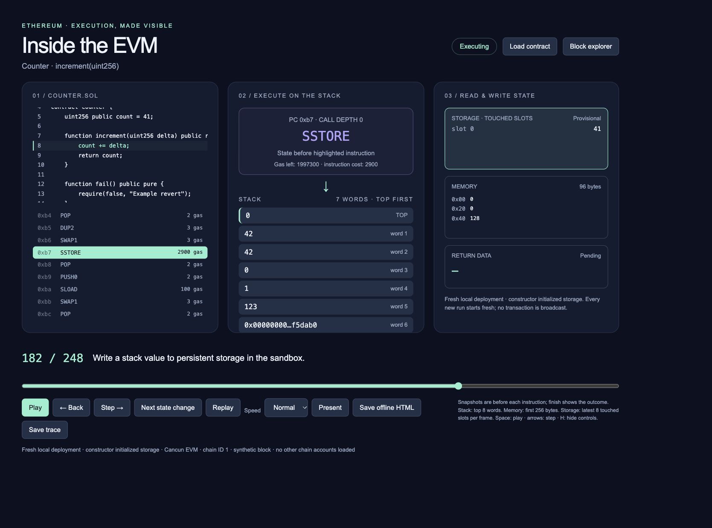
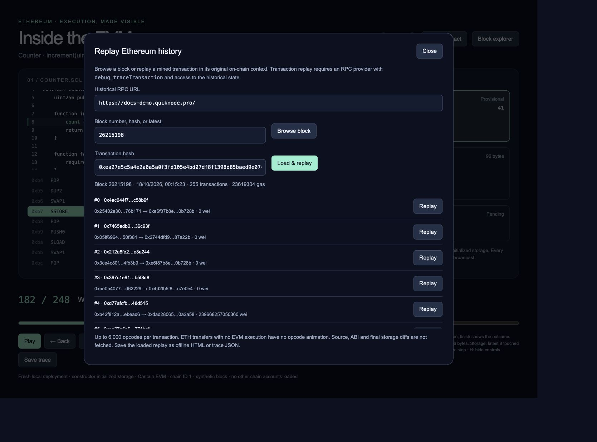
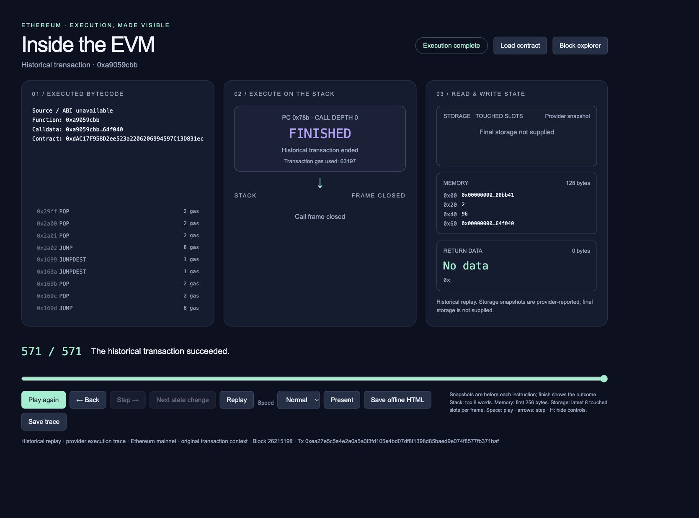

# Inside the EVM

**Watch smart contracts execute, one opcode at a time.**

Inside the EVM is a local, interactive Ethereum Virtual Machine explorer for learning, debugging, and presentations. Compile Solidity, load deployed bytecode, or replay a historical Ethereum transaction, then follow its instructions through the stack, memory, and storage.

The application runs in your browser with a small Node.js backend. No wallet or private key is required, and no transactions are broadcast.



*Follow a compiled Solidity call through the EVM. Here, the Counter is about to store its new value of 42.*

## Features

- **Solidity execution:** compile source files, select a function, supply arguments, and animate the actual execution trace.
- **Deployed contracts:** fetch runtime bytecode from an Ethereum mainnet address and run it in a fresh local sandbox.
- **Historical replay:** browse mainnet blocks or load a mined transaction by hash using a tracing-enabled RPC endpoint.
- **Execution controls:** play, pause, step forward or backward, scrub the timeline, and jump to the next memory, storage, call, or halt instruction.
- **State inspection:** view the program counter, gas, call depth, stack words, memory, and accessed storage slots.
- **Source highlighting:** follow Solidity source-map locations when executing locally compiled contracts.
- **Offline sharing:** save a self-contained HTML replay or a JSON trace.
- **Presentation mode:** fullscreen playback with keyboard controls, suitable for recording into a slide deck.

## Quick start

Download or clone this repository, open a terminal in the project directory, and choose one option.

### Node.js

Requires **Node.js 22 or newer**. Node.js 24 is recommended.

```sh
npm ci
npm start
```

Open **[http://127.0.0.1:8765](http://127.0.0.1:8765)**. Keep the terminal running and press **Ctrl+C** to stop the server.

### Docker Compose

Requires Docker with the Compose plugin. You do not need Node.js installed on the host.

```sh
docker compose up --build
```

Open **[http://127.0.0.1:8765](http://127.0.0.1:8765)**. Press **Ctrl+C** to stop, then remove the stopped container with:

```sh
docker compose down
```

The container runs as an unprivileged user. Compose publishes the app only on the host's loopback interface.

<details>
<summary>Docker without Compose</summary>

```sh
docker build -t evm-animation .
docker run --rm --init -p 127.0.0.1:8765:8765 evm-animation
```

</details>

The initial dependency installation or Docker build requires internet access. Afterward, local compilation and execution work offline. Fetching blockchain data requires access to an RPC endpoint.

## Try your first contract

The app opens with a ready-to-play execution of the included Counter contract.

To generate your own trace:

1. Click **Load contract**.
2. Upload [examples/Counter.sol](examples/Counter.sol), or use **Load Counter example**.
3. Click **Compile source**.
4. Select `Counter` and the function `increment(uint256)`.
5. Enter the function arguments as a JSON array:

   ```json
   ["1"]
   ```

6. Click **Run & animate**.

The constructor initializes `count` to `41`. The selected call increments it and returns `42`. The animation includes the compiler's function dispatch and overflow checks, not just the addition.

The constructor runs before the animated call; its execution is not animated. Each new run starts with a fresh deployment.

## Input formats

| Input | How to use it |
| --- | --- |
| Solidity files | Upload one or more `.sol` files, compile, and choose a contract and function. Include imported files. |
| Ethereum address | Fetch mainnet runtime bytecode with your RPC endpoint, then provide a function signature, ABI, or raw calldata. |
| Runtime bytecode | Paste hex or upload a `.hex` / `.bin` file. These files are treated as deployed runtime code. |
| Compiler artifact | Upload a single-contract JSON artifact containing an ABI and creation and/or runtime bytecode. |
| Saved replay | Upload a trace JSON exported by this app. The included examples also work. |

Compiler artifacts accept `abi`, `bytecode`, and `deployedBytecode`. Bytecode can be a string or an object with an `object` field; nested solc `evm.bytecode` fields are also supported. Artifacts with creation bytecode run a constructor before the call. A full solc output containing multiple contracts must first be reduced to a single contract artifact.

### Arguments and ABI encoding

Function and constructor arguments use JSON arrays. Quote large integers to avoid JavaScript number rounding:

```json
["1000000000000000000"]
```

Without an ABI, enter a function signature such as:

```solidity
balanceOf(address) view returns (uint256)
```

Then provide arguments:

```json
["0x0000000000000000000000000000000000000001"]
```

Include return types in a manual signature to decode the result. You can also choose **Raw calldata**. After fetching a contract by address, uploading its ABI JSON populates the function menu.

## Historical block explorer

Click **Block explorer** to browse blocks or replay a mined transaction.

1. Keep the default RPC URL or enter your own.
2. Enter a block number, block hash, or `latest`, then click **Browse block**.
3. Click **Replay** beside a transaction, or paste a transaction hash and click **Load & replay**.
4. Use the same animation controls and offline exports as for local execution.

The editable default endpoint is:

```text
https://docs-demo.quiknode.pro/
```

It was tested successfully with a 571-opcode mainnet transaction. As a shared demonstration endpoint, its availability and access policy may change; replace it with your own compatible endpoint when needed.



*Browse a block, choose a transaction, or enter its hash directly. The RPC endpoint is visible and editable.*

### Included historical example

[examples/quicknode-historical-trace.json](examples/quicknode-historical-trace.json) contains a captured mainnet replay:

| Field | Value |
| --- | --- |
| Block | `26215198` |
| Transaction | `0xea27e5c5a4e2a0a5a0f3fd105e4bd07df8f1398d85baed9e074f8577fb371baf` |
| Executed instructions | `571` |
| Result | Success |
| Transaction gas used | `63197` |

To replay it without a provider, choose **Load contract → Saved execution trace** and upload the JSON file.



*The included mainnet transaction replayed successfully through all 571 opcodes.*

### RPC requirements

Block browsing uses standard Ethereum JSON-RPC. Opcode replay additionally requires **`debug_traceTransaction` returning Geth-style `structLogs`**, with stack, memory, and storage capture. The provider must retain or reconstruct the historical execution state.

Support for `callTracer` or `prestateTracer` alone is insufficient for this animation. An archive endpoint does not necessarily expose opcode tracing. Unsupported requests produce an error; the app does not substitute an empty-state simulation.

Historical replay uses the original transaction context. It displays the receipt outcome, transaction gas, opcode snapshots, and call depth. It does not retrieve Solidity source, ABI definitions, final storage diffs, or nested call addresses. Receipt event logs are retained in exported JSON. Simple ETH transfers can have no EVM instructions to animate.

## Understand the execution modes

| Mode | Initial state | Gas displayed |
| --- | --- | --- |
| Solidity / creation artifact | Fresh local deployment, including constructors and field initializers | Message execution gas, excluding transaction intrinsic costs |
| Runtime bytecode / fetched address | Empty local storage; no other chain accounts loaded | Message execution gas, excluding transaction intrinsic costs |
| Historical transaction | Provider replay of the original mined transaction | Receipt transaction gas, including intrinsic costs |

**Address loading fetches code, not the contract's current state.** Storage starts at zero. Proxies, ownership checks, token balances, and external contract calls can therefore revert or behave differently from mainnet. A successful local call is not evidence that the equivalent mainnet call would succeed.

Local execution uses Cancun rules, chain ID `1`, a synthetic block, and a funded simulated caller. Block- and time-dependent behavior is synthetic. State is not preserved between runs. Constructor ETH value is zero; **Call value** applies to the selected function call.

## Playback and presentations

| Control | Action |
| --- | --- |
| Space | Play or pause |
| Left / Right arrow | Step backward or forward |
| R | Reset playback |
| H | Hide or show presentation controls |
| Escape | Exit presentation mode |
| Timeline | Jump to an instruction |
| Next state change | Jump to the next memory, storage, call, or halt instruction |

Keyboard shortcuts are inactive while editing fields or using a dialog. Arrow keys on the timeline control its native slider.

Stack and memory snapshots show the state **before** the highlighted instruction executes. Historical storage is the provider-reported accessed-slot snapshot, not a complete state diff. The final local frame shows the outcome and rolled-back storage after a failed call; historical final storage is not supplied.

- **Save offline HTML** creates a self-contained replay with the current trace and supplied source.
- **Save trace** exports replay data as JSON.
- **Present** requests fullscreen and hides controls.

For Keynote or other slide software, record the animation in a 16:9 browser window and insert the resulting movie into the deck. On macOS, **Shift+Command+5** opens screen recording controls. The interactive HTML itself runs in a browser.

The original 13-instruction teaching animation is available in [simplified.html](simplified.html).

## Limits

| Component | Limit |
| --- | --- |
| Solidity compiler | solc `0.8.30`, optimizer disabled, Cancun target |
| Local execution | 2 million message gas; 25-second worker timeout |
| Replay length | 6,000 opcodes; oversized traces are rejected |
| Visible stack | Top 8 words |
| Visible memory | First 256 bytes |
| Visible storage | Latest 8 accessed slots per frame |
| Historical trace retrieval | 60-second network timeout; 45-second requested node timeout; 32 MB response cap |

Compiler versions are not selected automatically. Missing imports, incompatible pragmas, and unlinked libraries must be resolved before execution. Local execution does not simulate rules introduced after Cancun; the EIP-4844 KZG precompile is outside this sandbox's scope.

## Data handling

Compilation and local execution happen on your machine. Blockchain requests are sent to the RPC endpoint you choose. The app does not connect to a wallet or submit transactions.

RPC URLs are excluded from saved HTML and JSON. Replays include their execution data: arguments, caller, addresses, return data, and any supplied Solidity source. Review exported files before sharing them.

Opening `index.html` directly supports playback and importing saved traces. Compiling, executing a new call, or fetching blockchain data requires the local server.

## Development

```sh
npm test
```

Or run tests inside the container:

```sh
docker compose run --rm evm-animation npm test
```

The automated suite covers compilation, constructors, imports, ABI encoding and decoding, storage initialization, rollback, invalid opcodes, replay limits, block browsing, historical normalization, and RPC errors. RPC tests use fixtures so the suite does not depend on a live provider. The included QuickNode replay was captured separately from a live mainnet request.

### Project structure

```text
.
├── index.html                 # Interactive UI and embedded example trace
├── simplified.html            # Original teaching animation
├── server.mjs                 # Local HTTP API
├── engine.mjs                 # Solidity compilation and local EVM tracing
├── history.mjs                # Block lookup and historical trace normalization
├── worker.mjs                 # Isolated compilation/execution worker
├── examples/                  # Solidity and saved replay examples
├── test/                      # Automated tests
├── Dockerfile
├── compose.yaml
└── START-HERE.md               # Additional setup and troubleshooting
```

## Troubleshooting

- **Port 8765 is already in use:** stop the other instance before starting Node or Docker.
- **Docker cannot connect:** start Docker Desktop or the Docker daemon.
- **New contracts cannot load from `file://`:** open the app at `http://127.0.0.1:8765` instead.
- **Historical tracing is unavailable:** verify opcode tracing and historical-state access with your provider.
- **A proxy returns empty data:** address mode has no implementation storage or external chain accounts. Use historical replay to inspect a real transaction.
- **Your RPC runs on the host while the app runs in Docker:** on Docker Desktop, use `host.docker.internal` in the RPC URL, and ensure the RPC service accepts the container connection.

See [START-HERE.md](START-HERE.md) for more setup guidance.

## Built with

- [EthereumJS EVM](https://github.com/ethereumjs/ethereumjs-monorepo/tree/master/packages/evm)
- [Solidity compiler](https://docs.soliditylang.org/en/latest/using-the-compiler.html)
- [ethers](https://github.com/ethers-io/ethers.js)
- Plain HTML, CSS, and JavaScript

For details about the historical trace format, see [Geth's tracing documentation](https://geth.ethereum.org/docs/interacting-with-geth/rpc/ns-debug).
